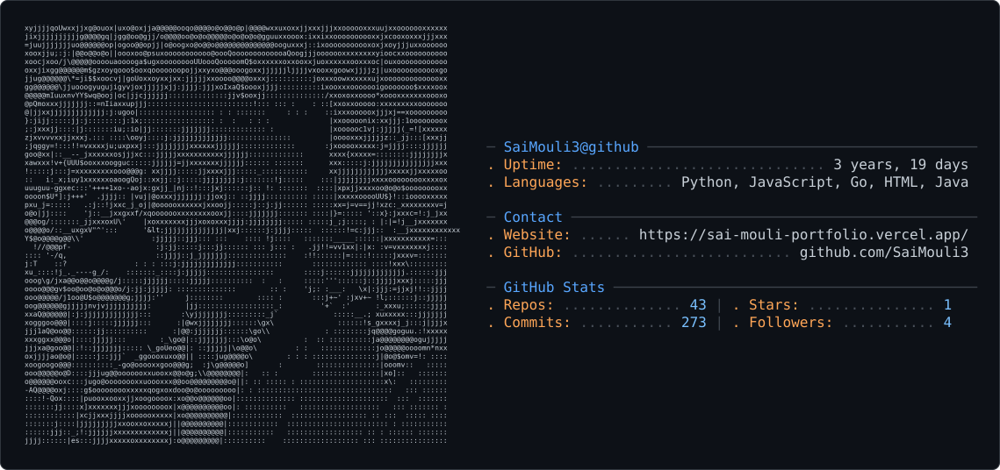

<picture>
  <source media="(prefers-color-scheme: dark)" srcset="dark_mode.svg" />
  <source media="(prefers-color-scheme: light)" srcset="light_mode.svg" />
  
</picture>

 

# Sai Mouli

**I build agents that read, fix, and ship code.**

Python · Go · TypeScript — LangGraph, MCP, Tree-sitter, Kubernetes

  

 

Most of my work sits at the point where a language model stops being a chat window and
starts being a process: an isolated sandbox, a real tool surface, retrieval over an
actual repository, and a pull request at the end of it. Lately I've been taking the
same interest upstream, into the libraries that make that possible.

 

---

## Selected work

### [xtxt](https://github.com/SaiMouli3/xtxt) · Go

**Plain text that machines can read — without guessing.**

Markdown makes an agent infer structure from prose. XTXT lets the document carry it:
images, tables, charts, and typed records in a file that still opens in any editor and
diffs cleanly in git. A written spec, a reference parser, and seven implementations.

 

### [autonomous-code-agent](https://github.com/SaiMouli3/autonomous-code-agent) · Python

**Give it a repo URL and a task. It opens the pull request.**

Clones into an isolated Docker sandbox, chunks the codebase with Tree-sitter, retrieves
the relevant functions by embedding similarity, edits, runs the tests, and pushes a real
PR. Every capability the agent has is exposed through an MCP server — so the tool surface
is inspectable, not buried in a prompt.

 

### [AI-Powered-Debugging-Agent](https://github.com/SaiMouli3/AI-Powered-Debugging-Agent) · Python

**A debugging pipeline that remembers.**

Five specialized agents in sequence: log parsing, root-cause analysis, fix generation,
validation against the test suite, then the PR. Past incidents land in a FAISS vector
store, so the system gets sharper on failure modes it has already seen. Works across
OpenAI, Claude, and Gemini.

 

### [Federated-Learning-Kube](https://github.com/SaiMouli3/Federated-Learning-Kube) · Python · Kubernetes

**Distributed training where the data never leaves the client.**

Clients train locally and publish only model updates; the server aggregates them into a
shared model. Kubernetes handles orchestration and scaling across the fleet.

 

---

## Open source

Contributing back to the infrastructure I build on.

`ResponseCachingMiddleware` cached every result it saw, including ones a tool returned with
`is_error=True`. A transient 503 or a rate-limit got pinned for the full hour-long TTL, so
every later call replayed the stale failure and the tool never ran again. Added the guard
alongside the passthroughs that already encode the same idea — some results describe a
moment, not an answer — plus tests covering the retry path.

 

Two API implementations annotated a return type as the string `"IndexingStatus"` without importing
the name. Because the annotation was a string, the missing import stayed invisible at
import time and only surfaced once something resolved type hints. Traced it to both call
sites, fixed, and added a regression test that needs no cluster to run.

 

Adds RFC 6570 explode support for list-typed query parameters, so array values expand
into repeated `key=value` pairs instead of a single comma-joined string.

 

Serializes a read-modify-write race in the event store's stream list that could drop
concurrent writes under load.

Also reading the tracker at **[pydantic](https://github.com/pydantic/pydantic)**.

 

---

## Elsewhere

### [SecurePass](https://github.com/SaiMouli3/SecurePass) · TypeScript

**A password vault that never sees your password.**

Client-side encryption end to end, so the server only ever stores ciphertext.

 

### [BankStatement_Extraction](https://github.com/SaiMouli3/BankStatement_Extraction) · Python

**Template-free bank statement parsing.**

OCR fallback for scanned statements, balance-reconciliation checks, and a
per-transaction confidence score.

 

---

[saimouli2023@gmail.com](mailto:saimouli2023@gmail.com)

